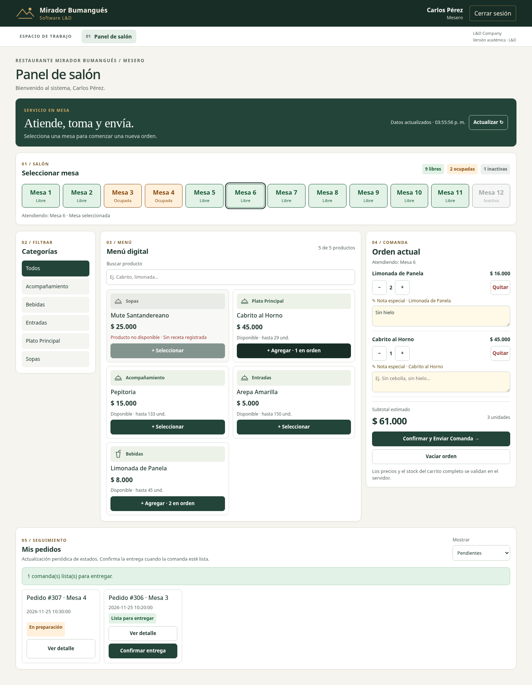
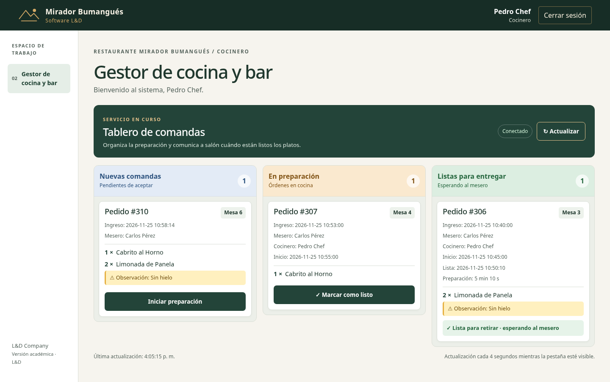
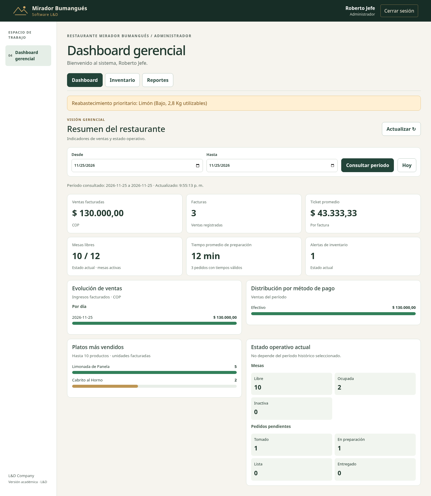

# Software Administrador de Restaurantes L&D

**Mirador Bumangués · MVP académico local · v1.0.0 prevista**

Aplicación web de gestión integral de restaurantes. Proyecto de Ingeniería de Sistemas, Universidad Cooperativa de Colombia, semestre 2026-2. Desarrollo: L&D Company (Larry Jimenez Bibanco y Diego Alonso Hernández).

## Funcionalidades

- Autenticación individual, hash scrypt, sesiones y autorización por roles.
- Salón: mesas, menú, disponibilidad, notas y pedidos.
- Cocina: tablero de comandas, preparación y entrega coordinada con salón.
- Caja: precuenta, registro manual de pagos, comprobante académico imprimible.
- Administración: inventario, alertas, movimientos, productos, recetas y empleados.
- Dashboard, reportes y descargas reales PDF/XLSX.
- Transacciones en MariaDB y auditoría mediante triggers.

## Arquitectura

```text
Navegador (HTML/Jinja, CSS, Bootstrap, JavaScript)
    ↕ HTTP/JSON
Flask → módulos backend → PyMySQL
    ↕
MariaDB: restaurante_pro_max → triggers → audit_pro
```

## Capturas de referencia

Las imágenes se generaron con respuestas simuladas durante el desarrollo; no representan ventas reales.





[Inicio](docs/capturas/LD_3_1_inicio.png) · [Caja](docs/capturas/LD_3_4_caja.png) · [Inventario](docs/capturas/LD_3_5_inventario.png) · [Reportes](docs/capturas/LD_3_6_reportes.png)

## Requisitos

Windows (instrucciones PowerShell), Python 3.11 o posterior compatible con las dependencias, MariaDB 10.11+, Git y navegador. La instalación de paquetes requiere internet. Bootstrap está incluido localmente. No usar el servidor de desarrollo Flask en producción.

## Instalación

Desde la raíz del repositorio clonado:

```powershell
py -3 -m venv .venv
.\.venv\Scripts\python.exe -m pip install -r requirements.txt
Copy-Item .env.example .env
```

Solo copiar `.env.example` si `.env` no existe. Configurar `DB_PASSWORD` con la contraseña propia de MariaDB y `SECRET_KEY` con una clave aleatoria de al menos 32 caracteres. Para generar una clave localmente:

```powershell
.\.venv\Scripts\python.exe -c "import secrets; print(secrets.token_hex(32))"
notepad .env
```

No publicar la salida ni el archivo `.env`. No utilizar root para Flask.

### MariaDB: instalación NUEVA, en una instancia de pruebas

Si `restaurante_pro_max` o `audit_pro` ya existen, **no ejecutar scripts de creación/migración sobre ellas**. Para comprobar la instalación desde cero, usar otra instancia de MariaDB o máquina virtual aislada. No borrar la instalación actual.

Desde PowerShell en la raíz, abrir el cliente (usar ruta absoluta si no está en PATH):

```powershell
mariadb -u root -p --default-character-set=utf8mb4 --abort-source-on-error
```

Dentro de MariaDB, comprobar `SHOW DATABASES;` y ejecutar uno a uno, solo si ambas bases están ausentes:

```sql
SOURCE database/01_ddl.sql;
SOURCE database/02_auditoria.sql;
SOURCE database/03_dml.sql;
SOURCE database/04_vistas.sql;
SOURCE database/08_migracion_manual.sql;
SOURCE database/09_demo_manual.sql;
SOURCE database/10_verificacion_manual.sql;
```

Detenerse ante cualquier error. Los DDL hacen commits implícitos; no repetirlos a ciegas. Los datos semilla son sintéticos y preservan identificadores de la demo. Los registros históricos no implican validez fiscal ni consumos históricos demostrados.

En PowerShell, crear un archivo privado (solo si no existe):

```powershell
Copy-Item database/05_dcl.example.sql database/05_dcl.local.sql
notepad database/05_dcl.local.sql
```

Sustituir los tres marcadores `CAMBIAR_CLAVE_*` por claves diferentes y aleatorias (20 caracteres alfanuméricos como mínimo). No ejecutar la plantilla sin editar. En MariaDB, verificar las cuentas existentes con `SELECT User, Host FROM mysql.user;`. Si las tres cuentas TCP no existen, ejecutar `SOURCE database/05_dcl.local.sql;`. Si ya existen, revisar permisos y reutilizar las cuentas correctas; no recrearlas. El usuario de aplicación necesita SELECT, INSERT, UPDATE y DELETE sobre `restaurante_pro_max.*`; no requiere acceso directo a auditoría. Los triggers deben conservar un definidor autorizado.

Configurar `.env` con el puerto y contraseña de `app_mirador`. Si MariaDB reconoce el acceso como `localhost`, revisar el host de la cuenta y sus permisos con el administrador.

### Configurar usuarios demo y arrancar

```powershell
.\.venv\Scripts\python.exe test_conexion.py
.\.venv\Scripts\python.exe configurar_claves_demo.py
.\.venv\Scripts\python.exe app.py
```

El configurador pide claves individuales de 12 a 256 caracteres y solo sustituye el marcador inicial `hash123` de las cuatro cuentas. No hay contraseña de acceso distribuida. Las demás cuentas semilla no tienen un hash válido para autenticarse; asignar una clave segura mediante gestión administrativa si se necesitan.

Abrir http://127.0.0.1:5000/login

| Usuario | Rol |
|---|---|
| `cperez` | Mesero |
| `pchef` | Cocinero |
| `ccaja` | Cajero |
| `rjefe` | Administrador |

## Pruebas

```powershell
.\.venv\Scripts\python.exe verificar_frontend.py
```

Suite acumulada prevista: 172 pruebas automatizadas con datos simulados. `test_conexion.py` consulta MariaDB; `prueba_integracion.py` registra una venta académica real previa confirmación y no debe repetirse indiscriminadamente. `medir_concurrencia.py` realiza un sondeo local de lectura de ocho sesiones con Flask activo. Resultados privados en `evidencias/`.

Scripts `06`, `07`, `10`, `11` y `12` sirven para consultas/verificaciones; revisar sus parámetros antes de ejecutarlos. No forman parte de las migraciones obligatorias (excepto la comprobación de lectura 10 indicada arriba).

## Estructura

```text
backend/       Lógica, API, permisos y conexión
database/      DDL, auditoría, datos demo, migración y verificaciones
static/        CSS, JS y Bootstrap local
templates/     Pantallas Jinja
docs/          Capturas simuladas y matriz de referencia
app.py         Entrada Flask
requirements.txt
.env.example   Plantilla sin secretos
test_*.py      Pruebas
```

## Alcance y limitaciones

MVP académico de ejecución local. POS sin validez fiscal; pagos registrados manualmente. No se integra DIAN/Sandbox, datáfonos, impresora térmica directa, sincronización Offline-First ni TLS de producción. Las notificaciones usan consultas periódicas. La prueba local de ocho sesiones no certifica ocho dispositivos físicos. No se afirma cumplimiento integral de requisitos de seguridad, rendimiento ni rentabilidad. Ver [matriz de referencia](docs/MATRIZ_CUMPLIMIENTO_REFERENCIA.md), que no contiene los resultados finales del equipo.

No subir contraseñas, respaldos, bases reales, evidencias con datos personales ni credenciales de terceros. No se ha definido una licencia de distribución del código propio: su publicación no equivale a conceder permiso de reutilización. Bootstrap conserva su licencia incluida.
